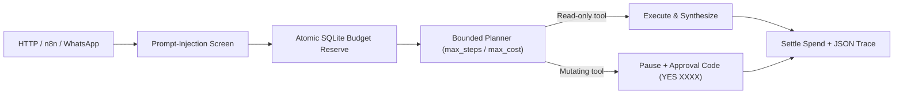

# guarded-agent-template

[](https://github.com/moutaz121493/guarded-agent-template/actions/workflows/ci.yml)
[](https://www.raspberrypi.com/)
[](LICENSE)

A **measurable, bounded Agentic AI microservice template** built with embedded-engineering discipline: explicit step limits, atomic SQLite cost caps, Human-in-the-Loop (HITL) approval gates for mutating tools, prompt-injection screening, and an automated CI evaluation harness.

Designed to run in **<100 MB RAM** on a Raspberry Pi 5 and plug directly into [`pi-n8n-ai-stack`](https://github.com/moutaz121493/pi-n8n-ai-stack) and [`whatsapp-agent-kit`](https://github.com/moutaz121493/whatsapp-agent-kit).

## Architecture



## Quickstart

```bash
git clone https://github.com/moutaz121493/guarded-agent-template.git
cd guarded-agent-template
cp .env.example .env
docker compose up -d --build
```

Test it immediately (zero API cost in default `mock` mode):

```bash
# 1. Health & remaining budget
curl -s http://127.0.0.1:8081/healthz | jq

# 2. Safe read-only tool call
curl -s -X POST http://127.0.0.1:8081/v1/run \
  -H "Content-Type: application/json" \
  -d '{"task": "Check homelab container health status"}' | jq

# 3. Mutating action -> pauses for Human-in-the-Loop approval
curl -s -X POST http://127.0.0.1:8081/v1/run \
  -H "Content-Type: application/json" \
  -d '{"task": "Restart worker-queue container"}' | jq
```

## Running it for real

The author runs this template 24/7 on a Raspberry Pi 5 (4 GB) next to his homelab:

- `AGENT_PROVIDER=groq` (OpenAI-compatible, Groq free tier, `openai/gpt-oss-20b`), `LLM_ANSWER=1` for answers in English, German or Arabic.
- `HEALTH_SNAPSHOT_DIR` points at a **read-only** mount of the Uptime Kuma status export, so health answers use real monitors. The agent has no Docker socket.
- `RESTART_MODE=dry-run`: the approval flow is real, the restart is not.
- `KB_PATH`: a small JSON file of real (public) homelab facts instead of the sample documents.
- Container: `read_only`, `cap_drop: ALL`, `no-new-privileges`, 128 MB / 0.5 CPU limits.

`GET /v1/stats?days=30` returns the measured numbers from the SQLite run log (no task text is stored):
runs per status, p50/p95 end-to-end and planner latency, and total cost. If the provider fails (network, quota,
invalid JSON), the run degrades to the offline planner instead of erroring, and `last_planner_error` says why.

## Automated Evaluation Harness

Every push runs `python3 evals/run_evals.py --provider mock` against `evals/dataset.jsonl` (12 multilingual EN/DE/AR cases covering read-only retrieval, HITL mutating actions, and prompt-injection blocks) and fails CI if pass rate drops below 100%.

## Engineering Guardrails

- **Atomic budget ledger (`app/budget.py`):** Reserves `max_cost_usd` before invoking any LLM and reconciles actual cost after, preventing race-condition overspend.
- **Deterministic HITL boundary (`app/tools.py`):** Every tool declares `mutating: bool`. Mutating tools *cannot* execute until `/v1/approve` receives the short-lived approval code.
- **Zero-cost injection screen (`app/agent.py`):** Blocks common English, German, and Arabic prompt-injection patterns before spending a single token.
- **Non-root minimal container:** Runs as UID `10001` with a `128m` memory limit.

See [SECURITY.md](SECURITY.md) for the threat model.
